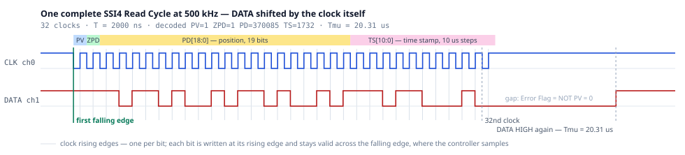
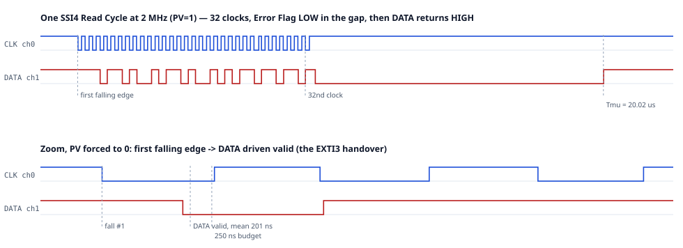

# stm32incoder — Zettlex IncOder emulator (SSI4) on NUCLEO-F446RE

Emulates a Zettlex/Celera Motion IncOder inductive angle encoder speaking the
**SSI4** protocol variant, on a NUCLEO-F446RE. The shaft angle comes from one
analog input; the SSI link is driven entirely by hardware — the incoming clock
itself shifts each bit out through DMA — so no interrupt runs per bit, and none
runs per frame on the data path at all.

Every register, pin and timing value in this project is taken from a document
in `docs/`, cited in the source. Nothing is guessed.

| Document | Used for |
|---|---|
| `docs/sensors/IncOder_Product_Guide_MIDI_ULTRA_Rev_4.11.8.pdf` | SSI protocol (5.4.1), SSI4 frame (5.4.2), update rate (4.12), zero point (5.2) |
| `docs/stm32/stm32f446mc.pdf` (DS10693 Rev 11) | pin alternate functions (Table 11), 5 V tolerance (Table 10) |
| `docs/stm32/rm0390-….pdf` (RM0390 Rev 9) | DMA request mapping (Tables 28/29), bus maximum frequencies |
| `docs/stm32/um1724-….pdf` (UM1724 Rev 17) | board connectors (Table 19/29), LD2, VCP, HSE options |

## Build and flash

```sh
git submodule update --init          # cmsis_core, cmsis_device_f4, hal_driver

cmake -B build -G Ninja -DCMAKE_TOOLCHAIN_FILE=cmake/arm-none-eabi.cmake \
      -DCMAKE_BUILD_TYPE=Release
cmake --build build
cmake --build build --target flash          # OpenOCD, board/st_nucleo_f4.cfg
```

Console/trace on the ST-LINK virtual COM port, **921600 8N1**:

```sh
stty -F /dev/ttyACM0 921600 raw -echo && cat /dev/ttyACM0
```

`SIMENC_CLOCK_SOURCE` defaults to **AUTO**: lock the 8 MHz ST-LINK MCO (HSE) if
the board's solder bridges provide it (UM1724 7.9.1, the factory setting), and
fall back to the internal 16 MHz RC otherwise. HSE is preferred because HSI
misses the Time Stamp accuracy specification — see
[Measured against the specification](#measured-against-the-specification). The
banner reports which oscillator locked. Force one with
`-DSIMENC_CLOCK_SOURCE=HSE` (hangs if absent) or `=HSI`.

### Build options

| Option | Default | Effect |
|---|---|---|
| `SIMENC_CLOCK_SOURCE` | `AUTO` | `HSE`, `HSI`, or try HSE and fall back |

The SSI clock must reach **PC6** (`TIM8_CH1`, morpho **CN10-4**). That is the
only clock input: it clocks TIM8, which is what shifts DATA out. Without it no
message ever completes and the link is simply dead — `stat` reports
`clock in PC6: NEVER REACHED n` rather than leaving that a puzzle.

How the bits get onto the wire is described in
[How each bit reaches the wire](#how-each-bit-reaches-the-wire).

## Pin map

All alternate functions verified in DS10693 Table 11; 5 V tolerance ("FT") in
Table 10; connector positions in UM1724 Tables 19 and 29.

| Signal | Pin | AF | Arduino | Morpho | I/O structure |
|---|---|---|---|---|---|
| SSI **CLOCK in** (slave) | **PC6** | **AF3 TIM8_CH1** | — | **CN10-4** | FT (5 V tolerant) |
| SSI **DATA out** (slave) | PB4 | GPIO out, written by DMA | CN9-6 (D5) | CN10-27 | — |
| Master CLOCK out (test) | PB10 | GPIO, driven by DMA | CN9-7 (D6) | CN10-25 | FT |
| Master DATA in (test) | PB14 | GPIO in, read via IDR | — | CN10-28 | FT |
| Angle analog in | PA0 | ADC1_IN0 | CN8-1 (A0) | CN7-28 | **0–3.3 V only** |
| Trace/console | PA2/PA3 | AF7 USART2 | — | — | to ST-LINK VCP |
| Status LED (LD2) | PA5 | GPIO | CN5-6 (D13) | — | — |

**There is one clock input.** PC6 clocks TIM8, which is what shifts each data
bit out, so that is the only pin the SSI clock has to reach. It is otherwise
unused on this board and is 5 V tolerant, so it takes the MAX490 receiver
output directly.

PB4 is a plain GPIO output throughout — the DMA writes it through `BSRR`. It
never belongs to a peripheral, so there is no alternate function to program and
no mode to flip mid-frame.

Both test-master pins are plain GPIO too: TIM1 compare events drive PB10 through
DMA writes to `BSRR`, and a third DMA samples PB14 through `GPIOB->IDR`.

> PB3 and PB5 carried the SPI1 clock and MOSI and are no longer used at all.
> PB3 is JTDO/TRACESWO, so SWO trace is free again.

## Console

USART2 → ST-LINK virtual COM port, **921600 8N1**. Commands are newline
terminated; `printf 'stat\r' > /dev/ttyACM0` works while a reader holds the port.

| Command | Effect |
|---|---|
| `help` | list the commands |
| `stat` | encoder and link state (see below) |
| `src adc\|fixed\|ramp` | select the position source |
| `fixed <counts>` | fixed position, 0…524287; also selects `fixed` |
| `ramp <step>` | counts added per 100 µs update; also selects `ramp` |
| `zero set\|reset` | set the zero point here, or restore the factory one (ZPD=1) |
| `err on\|off` | force PV=0, reporting the error condition |
| `ssi 1\|2\|4\|6\|9` | select the payload variant; **SSI4 is the default** |
| `wire` | loopback jumper continuity self-test |
| `clk <hz>` | test-master clock, any rate 100 kHz…2 MHz |
| `read [n]` | run *n* Read Cycles and decode each |
| `burst [n] [gapus]` | *n* cycles back to back, summary only — use for scope capture |

`read` also prints a diagnostic line after the burst — the three DMA `NDTR`
counters plus TIM1 and DMA2 status — which is what pinned down a clock that was
dying mid-burst. Ignore it unless something is wrong.

`stat` reports the position source, position, timestamp, PV/ZPD, the internal
update count, the raw ADC value, the zero offset, dropped trace bytes, whether
DATA is idle high, and three things about the master:

- `reads: full= short= aborted=` — Read Cycles that clocked all n bits and the
  Error Flag, ones that stopped at exactly n clocks, and ones that stopped
  earlier. **`short` climbing means the master sends n clocks instead of n+1**
  and is reading every frame one bit late; `stat` says so in plain words.
- `measured_T` — the clock period, from the last `full` Read Cycle.
- `tmu_arm` — how long staging and re-arming took at the end of the last Tmu.
  It is measured every cycle and taken out of the next one.

### State at power-on

| | Default |
|---|---|
| System clock | HSE if the ST-LINK MCO is strapped, else HSI — the banner says which, and flags `[timestamp OUT OF SPEC]` on the HSI fallback |
| Position source | `adc` — PA0, 0…VDDA mapped to 0…524287 counts |
| Zero point | factory, so ZPD = 1 |
| PV | 1 (`err off`) |
| SSI payload variant | **SSI4** — n = 32 bits, 19-bit position, 10 µs Time Stamp |
| SSI slave | armed, Tmu = 20 µs |
| Test-master clock | **500 kHz** (timer engine) |
| LD2 | blinks at 1 Hz; hold B1 to stream state |

The emulator is serving Read Cycles from reset — no command is needed to start
it. The console only changes what it reports and drives the loopback test
master, which is not part of the emulated device.

## SSI payload variants

The transport moves *n* bits and knows nothing of their meaning, so the payload
variants are sibling codecs in `ssi/ssi_variant.c`. `ssi <n>` switches between
them at runtime; it reconfigures the frame length, the position field width and
the Time Stamp tick, then re-arms.

| Variant | n | Layout (Product Guide 5.4.2) | Position | Time Stamp |
|---|---|---|---|---|
| SSI1 | 24 | D23 PV, D22 ZPD, D21-D0 PD | 22 bit | — |
| SSI2 | 24 | D23-D2 PD, D1 parity, D0 alarm | 22 bit | — |
| **SSI4** | 32 | D31 PV, D30 ZPD, D29-D11 PD, D10-D0 TS | 19 bit | 10 µs |
| SSI6 | 32 | D31-D24 CRC-8, D23 PV, D22 ZPD, D21-D0 PD | 22 bit | — |
| SSI9 | 32 | as SSI4 | 19 bit | 1 µs |

Verified on the wire with `fixed 0x12345`, each decoding back to 74565 and each
running `burst 100 50` at `ok=98 bad=0`:

```
ssi1  C12345      PV|ZPD|0x12345
ssi2  048D16      0x12345<<2, parity 1 (odd), alarm 0
ssi4  C91A2AA2    PV|ZPD|0x12345<<11|ts
ssi6  DFC12345    CRC-8 0xDF over the 24-bit body
ssi9  C91A2B92    as ssi4, TS counting in 1 µs steps
```

SSI7 (n=30) and SSI8 (n=18) are **not** implemented. Nothing in the data path
requires byte alignment any more — the DATA DMA moves n+1 words, whatever n
is — so what remains is the guard in `ssi_slave_set_frame_bits()` and the
codecs themselves.

All five re-checked on the current build at 500 kHz, `burst 100 50`, each
`ok=98 bad=0` with the raw frames above reproduced exactly.

**SSI2 and SSI6 passing in loopback is now meaningful**, where it used not to
be. They are the only variants carrying an integrity check — parity and CRC-8 —
and the test master decodes them with its own implementation. While the master
sampled a bit early every frame came back shifted, which breaks a checksum but
merely relabels a plain position field, so those two failed and the other three
passed. That asymmetry is what identified the sampling bug, and their passing
now is the evidence it is gone.

An earlier analyser run decoded all five in `tools/logic/variants.py` with
parity and CRC recomputed outside the firmware, confirming the SSI6 CRC-8 of
body `0xC12345` as `0xDF`. That run predates the timer data path; the frames it
checked are byte-identical to the ones above, but the timing figures from it
have been superseded.

**The SSI6 CRC is computed in software, and has to be.** The STM32F446 has a CRC
peripheral, but RM0390 4.1 describes "a *fixed* generator polynomial" and 4.2
names it: "CRC-32 (Ethernet) polynomial: 0x4C11DB7". There is no `CRC_POL` or
`POLYSIZE` register on this family — a programmable polynomial and width arrived
with F0/F3/L4/H7. SSI6 needs CRC-8 with polynomial 0x97, so the hardware unit
cannot produce it. The software version is 24 shift/xor steps inside
`stage_frame()`, which runs in the Tmu handler, off the bit path. It does run
*before* DATA returns HIGH, so its cost is part of `tmu_arm` — 0.1–0.2 µs
more than SSI4 — which is measured and compensated each cycle.

## Loopback testing

### Stage 1 — TTL loopback on the board (2 jumper wires)

Both wires land on the ST morpho connector **CN10**, and the DATA wire is
simply between two facing pins:

| Wire | From | To |
|---|---|---|
| CLOCK | **CN10-25** (PB10, master out) | **CN10-4** (PC6, slave in) |
| DATA | **CN10-27** (PB4, slave out) | **CN10-28** (PB14, master in) |

The DATA pair **CN10-27 / CN10-28 are directly opposite each other** across the
two rows of CN10, so a plain 2-pin jumper cap works there — no wire needed.

Check the wiring before anything else — the firmware can test it itself:

```
wire
```

It drives PB10 and PB4 as GPIO and checks that **PC6** and PB14 follow both
levels, printing `OK` or `OPEN` per wire:

```
CLOCK PB10(CN10-25,D6) -> PC6(CN10-4)     : OK
DATA  PB4 (CN10-27,D5) -> PB14(CN10-28)   : OK
loopback ready
```

It parks the transport first (`ssi_slave_stop()`) and re-arms afterwards. That
is not optional: the test toggles the clock pin, PC6 sees those edges, and
TIM8's DMA would otherwise write PB4 from under the test and report the DATA
wire OPEN when it is fine. The SPI path had the same hazard through EXTI3.

`stat` answers the other half — whether the clock is actually driving the
counter:

```
clock in PC6: counted n
```

That says a full message has been clocked. Do **not** test the tap by asking
whether the counter has seen an *edge*: a floating pin picks up enough noise to
answer yes while the link stays dead. Reaching *n* is the property worth
reporting.

Then:

```
src fixed
fixed 0x12345      # bypasses the ADC entirely
read 4             # runs 4 Read Cycles and decodes each frame
stat
```

`read` should report `pd=74565` (0x12345) with `pv=1`, `zpd=1`, and a `ts` that
advances between cycles, and `ef=0`: the test master sends n+1 clocks and its
last sample is the Error Flag, which must be the inverse of PV. With no jumpers
fitted you get `raw=FFFFFFFF ... EF-FAIL` instead — that is the master's idle
pull-up, and `reads: full=0` in `stat` confirms it.

### Test clock rates

`clk <hz>` sets the master clock. It is generated by TIM1 compare events driving
DMA writes to `GPIOB->BSRR`, so **any rate of the form 180 MHz / N is reachable**
across the whole specified window. N is bounded by the window itself: N = 90 is 2.000 MHz,
N = 1800 is 100.0 kHz. Resolution is coarsest at the top (1.1 % per step at
2 MHz, 0.06 % at 100 kHz).

Verified against the slave's own independent period measurement:

| Requested | Programmed | Slave measured T |
|---|---|---|
| 2 MHz | 2 000 000 Hz | 502 ns |
| 1 MHz | 1 000 000 Hz | 1002 ns |
| 500 kHz | 500 000 Hz | 2003 ns |
| 250 kHz | 250 000 Hz | 4005 ns |
| 100 kHz | 100 000 Hz | 10006 ns |

Every rate programmed exactly (+0.0 %), and `burst 40` decoded `ok=38 bad=0` at
each — `burst` skips two warm-up cycles, so it reports `n-2`. The power-on
default is **500 kHz**.


### Oversampling and the update rate

Two rates, easily conflated, and the guide fixes both:

- **Position latch: 10 kHz.** §4.12 gives "Internal Position Update Period
  < 0.1 millisecond", and §5.5.1 pins the value by describing ASI2 frames as
  "transmitted at a rate of 10kHz nominal (*same rate as Internal Position
  Update Period*)". So 100 µs is the specified rate, not a floor to beat.
- **Time Stamp tick: 10 µs**, i.e. a 100 kHz counter spanning 0.00…20.47 ms
  (§5.4.2). That 100 kHz is the *counter*, not the latch.

The emulator has always latched at 10 kHz and ticked TS at 100 kHz, which is
correct. What was wrong is what the latch averaged: four ADC samples taken *at*
the update rate, so every position was a moving average over the previous
400 µs — four update periods. TS claims to record when the position was
measured, and a 400 µs smear makes that claim false.

The ADC now free-runs and each update averages the 12 conversions taken during
that period (12 × 8.53 µs = 102 µs against the 100 µs period), which is both
genuinely per-period and worth about 1.8 bits of noise averaging.

### One-cycle data latency is intentional

A value changed between Read Cycles appears in the *next* frame, not the current
one: the payload is staged at the end of Tmu, matching "after Tmu, the latest
position data is now available for transmission in the next Read Cycle"
(5.4.1 note 4). A real encoder latches its data the same way.

Measured, changing `fixed` and reading immediately each time:

| after | Read Cycle 0 | Read Cycles 1+ |
|---|---|---|
| `fixed 0x12345` | 370085 *(previous)* | **74565** |
| `fixed 0x5A5A5` | 74565 *(previous)* | **370085** |
| `fixed 0x2AAAA` | 370085 *(previous)* | **174762** |

Exactly one cycle, and every stale frame is well formed — `pv=1`, `zpd=1`,
correct structure. `burst` skips two warm-up cycles rather than one: only one is
needed for the staging itself, the second is margin against a console command
landing mid-cycle.

### Stage 2 — RS-422 through two MAX490

A MAX490 has one driver and one receiver, which is exactly the SSI topology:
DATA is driven differentially by the encoder, CLOCK is received differentially.
Use two modules, U1 on the encoder side and U2 on the controller side.

```
DATA  (encoder -> controller)
  PB4  ──▶ U1.DI     U1.Y/Z ══twisted pair══▶ U2.A/B     U2.RO ──▶ PB14

CLOCK (controller -> encoder)
  PB10 ──▶ U2.DI     U2.Y/Z ══twisted pair══▶ U1.A/B     U1.RO ──▶ PC6
```

- **Supply:** MAX490 is a 5 V part — feed it from CN6-5 (+5V). Its RO outputs
  swing to ~5 V, which is safe because PC6 and PB14 are both `FT`. In the other
  direction the STM32's 3.3 V output clears the MAX490's ~2 V input threshold.
- **Ground:** tie the two modules' grounds together and to the Nucleo GND.
- **Termination:** the Product Guide states that DATA outputs and CLOCK inputs
  are *not* terminated with load resistors. Add 120 Ω at the receiving end only
  if you run a long pair.

**Verified on the RS-422 link**, with both pairs running through the two
modules, `fixed 0x5A5A5`, `burst 200 50` at each rate:

| Master clock | Result | Payload |
|---|---|---|
| 100 kHz | 198/198 | correct |
| 250 kHz | 198/198 | correct |
| 500 kHz | 198/198 | correct |
| 1.0 MHz | 198/198 | correct |
| 1.5 MHz | 194–197 / 200 | correct |
| 2.0 MHz | 196–198 / 200 | shifted one bit |

`resyncs=0` throughout, and all five variants were clean at 500 kHz.

**Those figures are from the SPI data path and are kept only as the RS-422
record.** Two of their findings have since been explained and fixed: the
one-bit shift at 2 MHz was the test master sampling one tick after the rising
edge, and the scatter at the top two rates went with it. On the current build
the same sweep over the bench wiring reads **198/198 at 100 kHz, 250 kHz,
500 kHz, 1 MHz, 1.5 MHz and 2 MHz** with the payload correct at every rate.
Whether the transceivers were still in line for that run is not recorded, so
treat the RS-422 column as needing one more pass.

## Conformance: clock edges and the Error Flag

Everything below is measured on the analyser, not inferred.

### How each bit reaches the wire

SSI puts each data bit on the CLOCK's **rising** edge; the controller then reads
it in the phase that follows, sampling on the **falling** edge. The first
falling edge only starts the Read Cycle and latches the position — no data moves
on it.

The sources agree:

- IncOder §5.4.1 note 2: "Each rising edge of the CLOCK transmits the next data
  bit of the message, starting with Dn-1."
- POSITAL: "With the following rising edge transition of the clock signal the
  transmission begins with the most significant bit (MSB). With each following
  rising edge transition of the clock signal, the next bit is set on the output
  of the data line."
- RLS: "The MSB then appears on the DATA output at the next rising edge… At each
  subsequent rising edge of the CLOCK the next bit is transmitted."

**No peripheral shifts the bits.** The incoming clock does it directly. TIM8 is
clocked by `TI1F_ED`, the channel-1 edge detector, which counts **both** clock
edges; with `ARR=1` the counter wraps on every second edge, and because the
clock idles HIGH the edges pair as (F1,R1), (F2,R2)… so the wrap always lands on
a rising edge. A frozen channel-2 compare with `CCR2=0` matches at that wrap and
raises one DMA request, which writes the next bit to `GPIOB->BSRR`.

**The Error Flag is placed the same way: it is simply word n+1.** A Read Cycle
is n+1 clock periods (see below), so the rising edge after the one that put out
D0 puts out the flag, with the same +56 ns and no interrupt.

Tmu is timed in hardware too. A channel-4 compare with `CCR4=1` matches on
every **falling** edge and its DMA request writes UG into `TIM6->EGR`, resetting
the Tmu timer. TIM6 overflowing therefore means exactly what §5.4.1 defines:
Tmu since the *last falling edge*, however many clocks the master sent.

What this buys, structurally rather than by tuning:

- **DATA changes on the rising edge**, +56 ns, which is DMA latency.
- **Nothing touches the line between F1 and R1** — no compare event exists
  there, so the first bit period cannot be disturbed.
- **No pin handover.** PB4 is a GPIO output for the whole cycle; only the
  *writer* changes. There is no 250 ns deadline and no interrupt in the bit path.
- **n need not be a multiple of 8**, which is what kept SSI7 and SSI8 out.



One complete Read Cycle, captured **before the Error Flag moved onto the
(n+1)th rising edge**, from an n-clock test master. The faint rules are the
clock's **rising** edges, one per bit; every DATA transition sits just after one
of them. The SSI4 fields are banded over the bit cells, and the caption's values
are decoded from the capture itself rather than copied in. The green rule is the
first falling edge, which starts the cycle and carries no data; the purple one
is where the Error Flag *used to* take the line, three quarters of a period
after R(n). It needs re-capturing with n+1 clocks.

Measured on the analyser at 500 kHz, 197 cycles, on that earlier build. The
data rows still describe the current path, which did not change; the Tmu row
does not:

| | result |
|---|---|
| Clocks per cycle | 32 on every cycle |
| **DATA after its rising edge** | **+56 ns**, 3740/3740 |
| **DATA moves between F1 and R1** | **0 / 197** |
| Payload sampled at the falling edge | **197 / 197 correct** |
| Tmu | 20.01–20.17 µs |
| Last data bit D0 survives to be sampled | yes — see the Error Flag below |

The +56 ns is 2.8 % of a bit period at 500 kHz and 22 % at 2 MHz, so the bit is
settled long before the controller samples it on the following falling edge.

**Both the clock taps and the probe must come off the same point.** For a while
DATA appeared to be written 72 ns *before* its rising edge. It was the wiring: a
second clock tap had been taken upstream of the MAX490 pair while the receiver
fed the other, so the timer was triggered by an early copy of the clock. With
one receiver feeding one pin this cannot arise; it was a bench artefact.

### What the loopback can and cannot prove here

The test master samples where the slave puts the data, and the two have to move
together. It samples late in the high phase, just before the next falling edge,
which is where an SSI controller reads.

Getting this wrong reads every frame shifted by one bit, and it did: the master
used to sample one timer tick after the rising edge, which was right while the
slave drove on the falling edge and became wrong when it moved to the rising
one. The slave puts each bit up 56 ns after that edge, so a sample 5.6 ns after
it captured the *previous* bit, and `fixed 0x5A5A5` read back as 447186 —
`(pd >> 1) | (ZPD << 18)` exactly.

**The loopback also cannot find a bug the master and the slave share**, and for
a long time they shared one: both assumed a Read Cycle of n clocks. And because
`read` and `burst` block the main loop while they clock, nothing that runs from
the main loop is exercised by them at all. The first external controller on the
link exposed both — see the next two sections.

### What the controller has to send

§5.4.1 defines the Read Cycle as **Trc = n·T + 0.5·T**, from the first falling
edge to the last rising edge. That is n+1 clock periods:

| Edge | What happens |
|---|---|
| F1 | starts the Read Cycle. **No data.** |
| R1 … R(n) | the sensor puts out D(n-1) … D0 |
| F2 … F(n+1) | the controller samples D(n-1) … D0 |
| R(n+1) | "the last rising edge": the line goes to the Error Flag |
| last falling edge + Tmu | DATA returns HIGH |

A controller that sends only n clocks has to take its first sample at F1, or
right at R1 before DATA has moved, and that sample is the idle HIGH. Everything
after it is one place late:

```
received = (1 << (n-1)) | (frame >> 1)
SSI4, position 0, ZPD=1   ->   PD reads 0x40000, TS counts by 5 and wraps at 1023
```

`stat` shows this from the slave's side as `short` reads.

**From an SPI peripheral**, which is how such a controller is usually built:

- Sample on the edge the *sensor* sees falling. With a clock that idles HIGH at
  the sensor that is CPOL=1/CPHA=0 — or CPOL=0/CPHA=0 through an inverted pair.
  Sampling on the sensor's rising edge races the data it is changing.
- Send at least n+1 clocks. With 8-bit frames SSI4 takes 5 bytes, 40 clocks;
  the extra ones only restart Tmu.
- Discard the first bit, take the next n as D(n-1) … D0, and the one after as
  the Error Flag:

```c
uint64_t raw = ((uint64_t)b[0] << 32) | ((uint32_t)b[1] << 24) | (b[2] << 16) | (b[3] << 8) | b[4];
bool     start = (raw >> 39) & 1;        /* idle level at F1: always 1 */
uint32_t frame = (uint32_t)(raw >> 7);   /* D31..D0, sampled on F2..F33 */
bool     ef    = (raw >> 6) & 1;         /* Error Flag, sampled on F34 */
```


### The Error Flag, and the last data bit

§5.4.1 note 3 hands the data line to the Error Flag "after the last rising edge
of the clock sequence". Read with n clocks in mind that looks unimplementable:
the last rising edge is the one that *writes* D0, so a flag placed there
destroys the bit before any controller can sample it.

It is not unimplementable; the Read Cycle has n+1 clocks. The last rising edge
is R(n+1), one period after D0 went out, and by then the controller has sampled
D0 on F(n+1). The flag is the next word in the same DMA buffer.

Three earlier attempts, all built on n clocks, kept here because each looked
reasonable and each was measured:

| Attempt | What happened |
|---|---|
| Flag driven from the end-of-message interrupt, ~416 ns after R(n) | landed 567 ns *before* the controller sampled D0 at 500 kHz; `ssi 1 ; fixed 0x3FFFFF` read back 4194302, bit 0 lost in every frame |
| Flag placed by a gap timer, 0.75·T after R(n) | D0 survived, but the flag took the line ~3 µs late and the delay had to be scaled to a measured T |
| A second DMA on the falling-edge compare, flag at index n | "needs an (n+1)th falling edge that a Read Cycle does not have" — true of the n-clock test master, not of the guide |

The check that catches a flag that is not being driven at all is to **compare
the gap level between PV=1 and PV=0** (`err on`). Looking for extra transitions
does not: a stale last data bit is nearly constant for a `fixed` payload.

**For a controller that sends only n clocks** the flag is never clocked out:
DATA holds D0 until Tmu ends. That is the controller's deviation, not the
emulator's, and `stat` reports it as `short`.

**Status.** Running on hardware against an external SPI master at 562.5 kHz:
with SSI1 (n+1 = 25 ≤ its 32 clocks) every read counts `full` and `measured_T`
reads 1776 ns; with SSI4 (n = 32 = its clocks) every read counts `short`.
Neither the flag on R(n+1) nor Tmu from the last falling edge has been captured
on an analyser yet.

## Measured against the specification

Captured with a Saleae Logic Pro 16 at 125 MS/s (8 ns resolution), 3.3 V
threshold, triggering on the clock, with `fixed 0x5A5A5` and `burst`, run once
with PV=1 and once with `err on`. HSE locked.

**Everything in this section predates two changes and has not been re-captured:**
the test master now sends n+1 clocks, and Tmu is timed from the last falling
edge by hardware instead of by a correction on a measured T. The clock, payload
and DATA-edge rows describe a path that did not change. The Tmu rows, and the
two paragraphs about the "dynamic correction", describe a mechanism that no
longer exists.

Re-capture with `tools/logic/` after touching the SSI path. An earlier revision
of this section was silently stale for exactly that reason, and a later one
reported a defect as fixed on a measurement that could not have detected it —
see the Error Flag section for how that happened and what test actually catches
it.

### 500 kHz against 2 MHz

2 MHz is the top of the specified range, and on this data path it is not a
special case — there is no handover, no deadline and nothing to tighten, so it
measures like any other rate.



| | 500 kHz | 2 MHz |
|---|---|---|
| Clock rate | 0.5000 MHz | 2.0005 MHz |
| Clocks per cycle | 32 on every one | 32 on every one |
| Payload | 197/197 | 197/197 |
| DATA after its rising edge | +56 ns, 3740/3740 | +56 ns, 3739/3739 |
| — as a fraction of the half period | 2.8 % | 22 % |
| DATA moves between F1 and R1 | 0 | 0 |
| Tmu (spec 20 µs ± 1) | 20.01–20.17 µs | 19.97–20.12 µs |

Also measured at 100 kHz, the other end of the window: 32 clocks, +56 ns,
197/197, Tmu 20.02–20.19 µs. All three rates sit inside 20 ± 1 µs from the same
dynamic correction, across a 20× span of clock period.

All three land inside the window from the same dynamic correction, which is the
point of measuring `T` per frame rather than assuming it: the half-period term
it removes is 5 µs at 100 kHz and 0.25 µs at 2 MHz. Lose that measurement and
the ends diverge by exactly that much — which is what happened when the SPI
removal orphaned it on a deleted DMA stream, and Tmu silently spread from 19.66
to 20.43 µs across the range.


## Architecture

Layered so the SSI transport can be reused for the other SSI payload variants:

```
encoder/incoder.c        sensor behaviour: position, zero point, timestamp, PV/ZPD
        ↑
ssi/ssi_variant.c        SSI payload codecs — pure logic, no hardware
        ↑
ssi/ssi_slave.c          generic SSI slave transport (TIM8 + DMA + Tmu gap)
```

"Generic" here means **payload-agnostic, not hardware-agnostic**: `ssi_slave`
moves *n* bits and knows nothing of their meaning, so SSI1/2/6/9 (all
byte-aligned) live as further codecs in `ssi_variant.c`. It is still
specifically the TIM8+DMA transport — porting to another part means editing it,
not swapping a back end.

`ssi/ssi_master.c` is a bring-up instrument, not part of the emulated device.

### How a Read Cycle is served

1. Between messages PB4 is a GPIO output holding the SSI idle-HIGH level. It
   stays a GPIO output for the whole cycle; only the *writer* changes.
2. On arming, the next frame is expanded into one `BSRR` word per bit, the DMA
   is loaded with them, and TIM8's counter is zeroed and started.
3. The master's **first falling edge** is counted but raises no compare, so
   nothing happens on the line. There is no handover and no deadline.
4. Each **rising** edge wraps the counter, matching the CH2 compare, and the DMA
   writes the next word: D(n-1) … D0 on R1 … R(n), then the Error Flag on
   R(n+1).
5. Each **falling** edge matches the CH4 compare, and a second DMA writes UG
   into TIM6, restarting Tmu. That goes on for as many clocks as the master
   sends.
6. When no falling edge has come for Tmu, TIM6 overflows. Its handler counts the
   Read Cycle as full, short or aborted, stages the next frame, re-arms, and
   only then returns DATA to HIGH. The time that took is read off TIM6 and
   taken out of the next cycle's Tmu.
7. TIM6 is parked on a 6.5 ms period until the next first falling edge loads
   Tmu again, so an idle line costs almost nothing.

Position and timestamp are latched **together** by the 100 µs update tick, so
`TS` reports when the position was measured rather than when it was sent.

### Peripheral allocation

| Peripheral | Role | DMA (RM0390 Tables 28/29) |
|---|---|---|
| **TIM8** | **clocked by the SSI clock on PC6 (TI1F_ED, both edges, ARR=1); the CH2 compare shifts each bit and the Error Flag, the CH4 compare restarts Tmu** | **CH2→DMA2 S3 C7 → `GPIOB->BSRR`; CH4→DMA2 S7 C7 → `TIM6->EGR`** |
| TIM6 | Tmu since the last falling edge, 0.1 µs tick; reset by DMA, never by an interrupt | written by DMA2 S7 |
| TIM7 | Time Stamp counter, 10 µs tick, wraps 2048 | — |
| TIM2 | 10 kHz update tick + ADC trigger (TRGO) | — |
| ADC1 IN0 | angle acquisition | DMA2 S0 C0, circular |
| USART2 | trace/console | TX DMA1 S6 C4 |
| **TIM1** | **test-master clock, any 180 MHz / N** | **CH1→DMA2 S1 C6 (clock low), CH3→S6 C6 (clock high), CH4→S4 C6 (sample IDR)** |

The DATA stream must be on DMA2: GPIO is on AHB1 and DMA1 cannot reach it. That
is also why the timer is TIM8 — it is the free APB2 timer, and APB2 timer
requests land on DMA2. No SPI is involved anywhere, at either end of the link.

## Design decisions that are *not* from the specification

- **The analog input is 3.3 V only — there is no 5 V-capable ADC pin, and no
  way to make one.** DS10693 gives the ADC conversion range as `VAIN` =
  0…**VREF+**. The `FT` marking describes the *digital* I/O structure; in analog
  mode the pad switches straight onto the ADC sampling capacitor, so PA0 being
  `FT` does **not** make it a 5 V analog input.

  Neither supply trick helps. On the LQFP64 the datasheet pinout labels pin 13
  **`VDDA/VREF+`** and pin 12 **`VSSA/VREF-`** — VREF+ is internally bonded to
  VDDA, so raising VREF+ *is* raising VDDA. And DS10693 Table 13 gives the
  absolute maximum for "External main supply voltage (including VDDA, VDD,
  VDDUSB and VBAT)" as **4.0 V**, with an operating range of 1.7–3.6 V. Feeding
  5 V to VDDA/VREF+ — with or without SB57 removed — exceeds the absolute
  maximum and would damage the part, and VDDA also feeds the RCs and PLL, not
  just the ADC. Removing SB57 is only useful for supplying a *cleaner* reference
  from CN5 pin 8 within 1.7–3.6 V (keeping VDDA − VREF+ < 1.2 V).

  Scale a 5 V source with a divider instead, keeping the source impedance under
  the 50 kΩ `RAIN` limit: 5.1 kΩ / 10 kΩ gives 5 V → 3.31 V at ~3.4 kΩ.
- **Analog → angle mapping.** 0 V…VDDA maps linearly onto the full position
  field — 0…524287 counts for SSI4's 19 bits, 0…4194303 for the 22-bit
  variants, both endpoints exact. The oversampled *sum* is what gets scaled,
  not the 12-bit average, so the averaging gain is not thrown away first.

  That spans the IncOder's numeric range but does not manufacture its
  precision: the source is a 12-bit ADC, and averaging 12 samples is worth
  about 1.8 bits more (√12), and only where the input carries enough noise to
  dither. Honest 19-bit acquisition would need 4⁷ = 16384 samples per update,
  which does not fit a 100 µs period. A real IncOder gets its resolution from
  the inductive front end, not from an ADC like this one.
- **19-bit resolution.** SSI4 caps measurement resolution at 19 bits, so the
  emulator presents the maximum the variant allows.
- **Update rate 10 kHz.** The guide specifies "< 0.1 ms"; 100 µs is the fastest
  value satisfying it.
- **Ready before DATA says so.** The guide holds the Error Flag for
  `Tmu − 0.5·T`, from the last rising edge to Tmu after the last falling one,
  and both ends are now set by hardware. What is a choice is the order at the
  end: the next frame is staged and the transport re-armed *before* DATA goes
  HIGH, so a controller that starts on seeing HIGH is never early. That work
  takes 3.9–5.0 µs depending on the variant, so it is measured each cycle and
  subtracted from the next Tmu rather than assumed.

## Known limitations

- **The SSI clock must reach PC6** (CN10-4). It is the only clock input, and
  without it nothing works at all — `stat` says `clock in PC6: NEVER REACHED n`.
- `ssi_slave_set_frame_bits()` still rejects frame lengths that are not a
  multiple of 8, so SSI7 (n=30) and SSI8 (n=18) remain unimplemented. Nothing in
  the data path requires that any more — the DATA DMA moves n+1 words,
  whatever n is — so the restriction is now only the guard and the variant
  table.
- **The Error Flag on R(n+1) and Tmu from the last falling edge are not yet
  captured on an analyser.** They run on hardware and `stat` is consistent with
  them, but the figures under "Measured against the specification" are from the
  mechanism they replaced.
- **A controller that sends n clocks never sees the Error Flag** and reads the
  frame one bit late. That is correct emulation of what the real sensor would
  do to it; `stat` flags it as `short` — see
  [What the controller has to send](#what-the-controller-has-to-send).
- **A clock parked LOW is not handled.** Re-arming assumes the SSI idle level,
  HIGH. A master that stops mid-bit with the clock LOW is re-armed out of step
  with it.
- The SSI6 CRC is checked against our own implementation of the guide's
  parameters, which proves round-trip consistency rather than conformance to an
  external reference vector.
- Single-turn only; the multi-turn variants (SSI31/32) are not implemented.
- There is **no per-frame deadline left**. The old SPI path had to hand the
  DATA pin over within half a clock period of the first falling edge — 250 ns at
  2 MHz, with about 10 % margin. That handover no longer exists, so neither does
  the deadline or the interrupt priority built around it.
